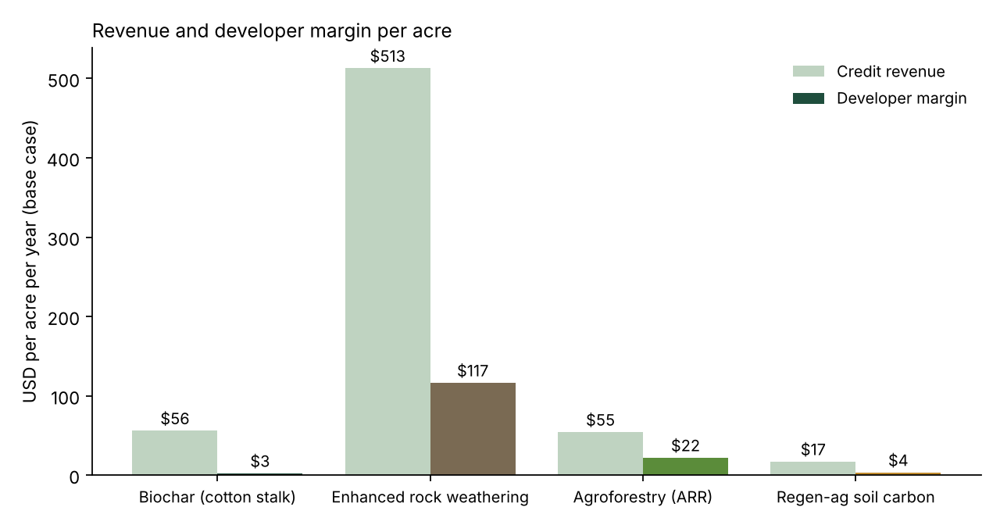
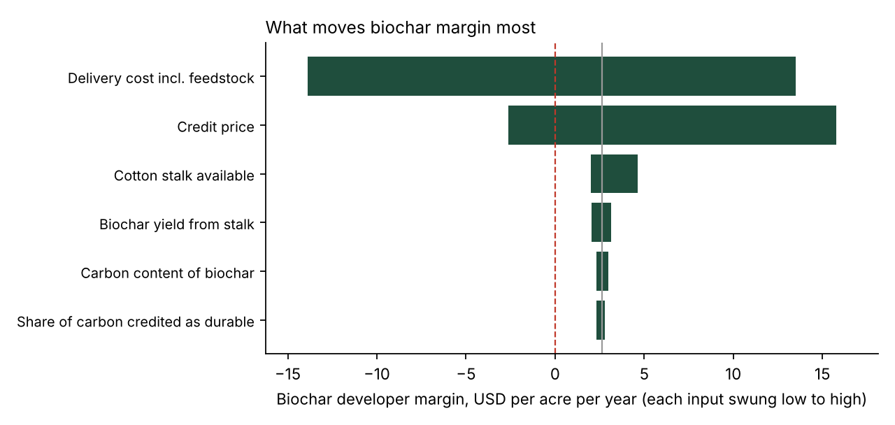
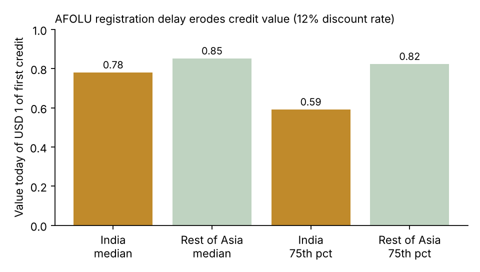

# Carbon Removal Unit Economics: Biochar vs ERW vs Agroforestry vs Regen-Ag

Per-acre and per-tonne economics of four carbon removal pathways for **Indian smallholder projects**, built as a live Excel model plus a Python uncertainty analysis. Every input is a low / base / high range with its public source (or is labelled as an assumption) in [`data/inputs.csv`](data/inputs.csv).

> All results are **model outputs** on public prices and stated assumptions. They are not results from any real project.

## Key findings (base case)

| Pathway | Credited tCO2e / acre / yr | Price (USD/t) | Revenue / acre | Farmer income / acre | Developer margin / acre | Margin / t | P(margin > 0) |
|---|---|---|---|---|---|---|---|
| Biochar (own-field cotton stalk) | 0.375 | 150 | USD 56 | in feedstock price | USD 2.6 | USD 7 (4.7%) | 69% |
| Enhanced rock weathering | 1.458 | 352 | USD 513 | n/a | USD 117 | USD 80 | 86% |
| Agroforestry (ARR) | 2.669 | 20.44 | USD 55 | INR 2,565 | USD 22* | USD 8.3* | 99.6%* |
| Regen-ag soil carbon | 0.808 | 21.5 | USD 17 | INR 817 | USD 3.7 | USD 4.6 | 90% |

\* before tree planting and practice-change costs, which are not modelled.

1. **Biochar margin is decided by cost, not carbon yield.** A USD 150 price against the USD 143 supplier breakeven leaves USD 7 a tonne. In the tornado, delivery cost and price swing margin far more than stalk supply, yield or carbon content.
2. **Soil carbon is an MRV-cost business.** MRV at USD 5 an acre takes 58% of the developer's share; the farmer earns about INR 817 an acre a year (P10 to P90: INR 566 to 1,722), within the USD 20 to 70 per hectare range seen in smallholder pilots.
3. **India's slower AFOLU registration (CEEW) costs 8% of each credit's value at the median and 28% for the slowest quarter** of projects, at a 12% discount rate.
4. **Dose check on my own pot trial:** the best 2% w/w biochar dose equals about 42 t per hectare, about 99 years of what one hectare's own cotton stalks can make, so field trials should test much lower doses.





## What is in the repo

| Path | What it is |
|---|---|
| `model/Carbon_Removal_Unit_Economics.xlsx` | Live Excel model: 91 formulas on named input cells; type in the yellow Override column to test a scenario |
| `data/inputs.csv` | 27 inputs, each with low / base / high, basis (sourced, mixed or assumption) and source URL |
| `src/model.py` | Same calculations in Python (vectorised) |
| `src/montecarlo.py` | 20,000-draw Monte Carlo (triangular ranges, seed 7) and one-way tornado |
| `src/verify_excel.py` | Checks the recalculated workbook equals the Python model |
| `results/` | `summary.json`, `pathway_comparison.csv` |
| `docs/executive_memo.md` | One-page memo with recommendations |
| `docs/farmer_onboarding_playbook.md` | Draft SOP: 9 onboarding stages mapped to the model's KPIs |
| `tests/` | 7 pytest tests (carbon chain, revenue split, PV, dose check, Monte Carlo reproducibility) |

## Method
- **Biochar:** cotton stalk per acre x biochar yield x carbon content x 44/12 x durable share = credited tCO2e; margin = price - supplier breakeven (which includes feedstock).
- **ERW:** gross removal x (1 - uncertainty deduction); margin = price - supplier breakeven.
- **ARR and soil:** removal x (1 - buffer/uncertainty) x price = revenue; farmer gets a revenue share; developer pays MRV per acre.
- **Time value:** first credit discounted by (1 + r)^-years to first issuance; India vs rest-of-Asia registration times from CEEW.

## Run it
```bash
pip install -r requirements.txt
python -m pytest -q tests
python src/run_all.py          # writes results/, charts/ and the Excel model
python src/verify_excel.py     # after recalculating the workbook in Excel or LibreOffice
```

## Limits (read before using the numbers)
- Prices and supplier breakevens are mostly global (CDR.fyi, OPIS, Sylvera, Ecosystem Marketplace); Indian costs may differ.
- Several inputs are assumptions and are labelled as such (discount rate, base farmer share, deductions, biochar carbon content and durable share).
- ARR planting and soil practice-change costs, registry fees, taxes and financing are not modelled.
- Monte Carlo draws inputs independently; real prices and costs may move together.
- The dose check uses a pot-trial dose from my own study, whose growth differences were not statistically significant (n = 9, p > 0.05).
